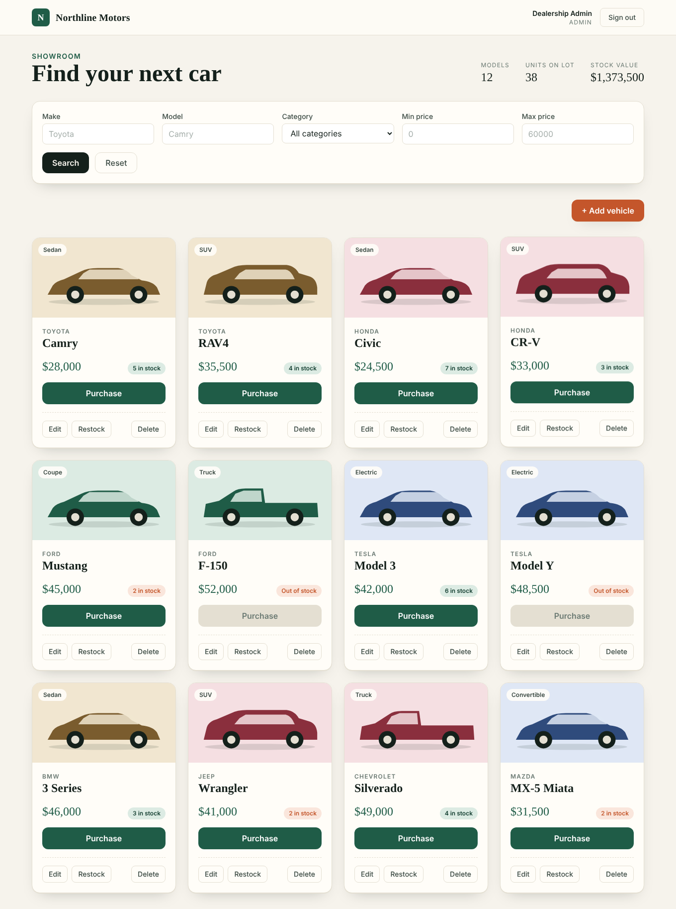
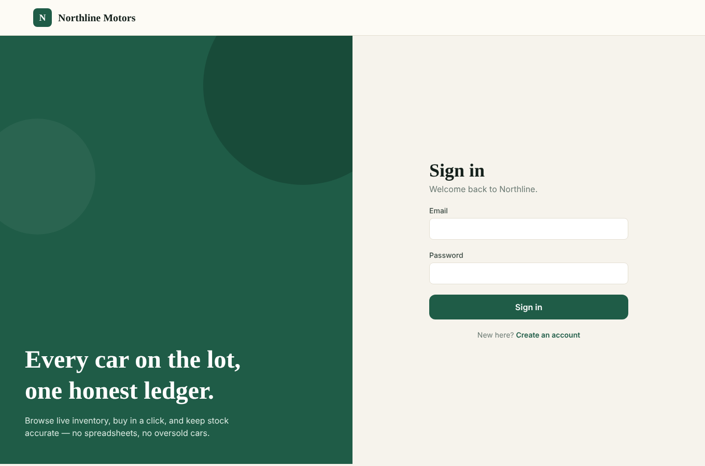
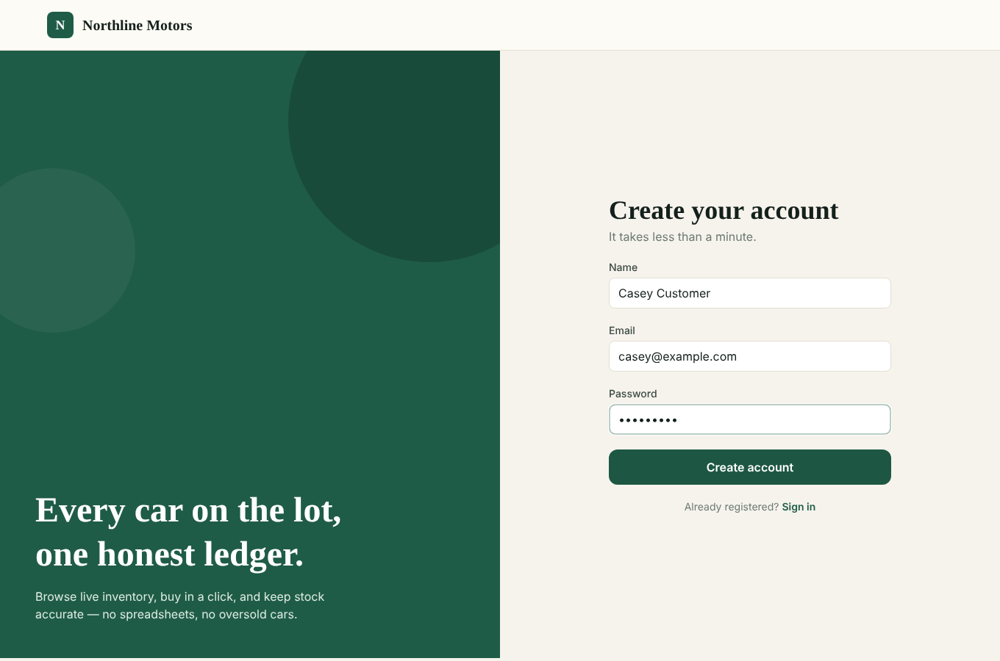
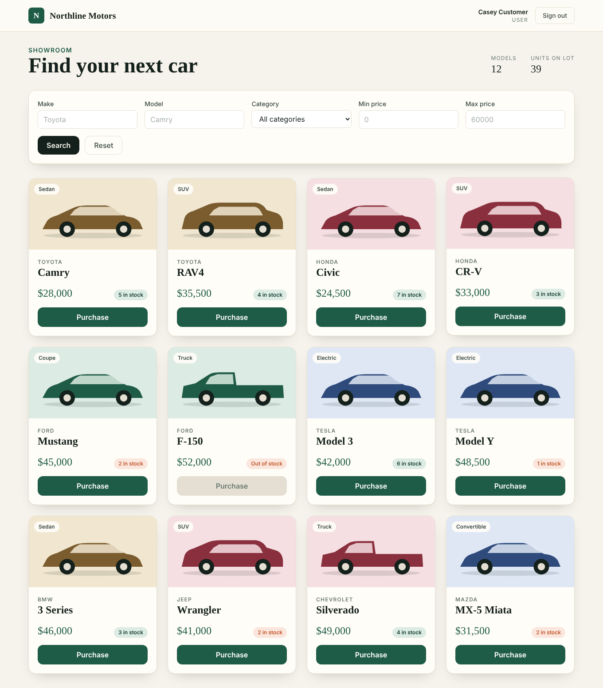
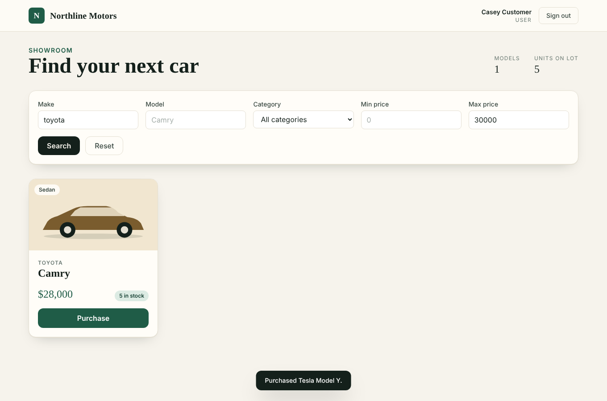
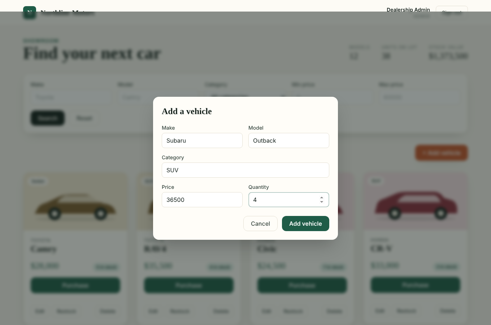
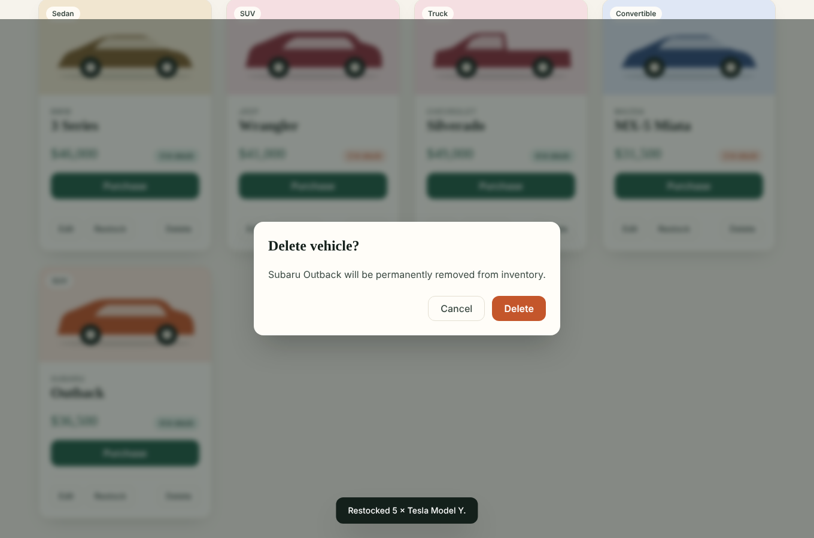
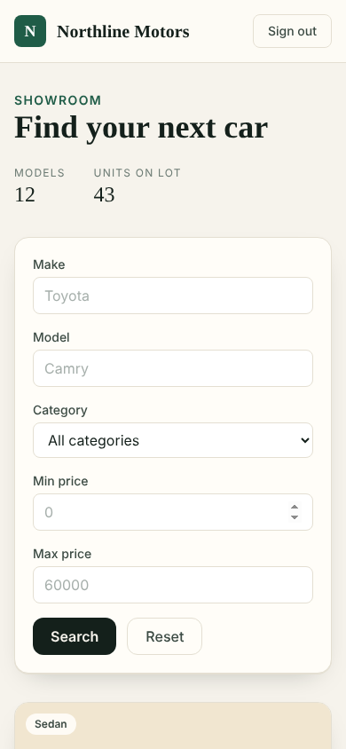

# Northline Motors - Car Dealership Inventory System

A full-stack inventory system for a car dealership, built test-first.

- **Backend:** Node.js + TypeScript + Express, **SQLite** (file-backed via `better-sqlite3`), JWT auth, Zod validation
- **Frontend:** React 18 + TypeScript + **Tailwind CSS** (Vite), HTML5/CSS3
- **Tests:** Jest + Supertest (API), Vitest + React Testing Library (UI) - **96 tests, ~99% line coverage**

Customers can register, sign in, browse and search the catalogue, and purchase vehicles. Admins can additionally
add, edit and delete vehicles and restock inventory.



## Screenshots

| Sign in | Create account |
|---|---|
|  |  |

| Customer dashboard | Search & filter |
|---|---|
|  |  |

| Admin: add vehicle | Admin: confirm delete |
|---|---|
|  |  |

| Mobile (390px) |
|---|
|  |

## Running it locally

**Requirements:** Node.js 22+ and npm. No separate database server is needed; SQLite is a file.

```bash
git clone <(https://github.com/Ankithasriram10/car-dealership-inventory.git)> && cd car-dealership
npm run install:all          # installs backend + frontend dependencies
```

### 1. Backend (http://localhost:4000)

```bash
npm run seed                           # creates demo users + 12 vehicles
npm run dev:api                        # or: cd backend && npm run dev
```

> Defaults work out of the box. The backend reads real environment variables (it does not load `.env` files),
> so to customise, set them inline, e.g. `JWT_SECRET=... PORT=4000 npm run dev:api` (`backend/.env.example` lists the names).

| Variable | Default | Purpose |
|---|---|---|
| `PORT` | `4000` | API port |
| `DB_PATH` | `./data/dealership.db` | SQLite file (created automatically) |
| `JWT_SECRET` | dev-only fallback (warns) | **Set this in any real deployment** |

### 2. Frontend (http://localhost:5173)

In a second terminal:

```bash
npm run dev:web
```

Vite proxies `/api` to `localhost:4000`, so no CORS or URL configuration is needed in development.
For a separately hosted API, set `VITE_API_URL` (see `frontend/.env.example`) and run `npm --prefix frontend run build`.

### Demo accounts (created by `npm run seed`)

| Role | Email | Password |
|---|---|---|
| Admin | `admin@dealership.com` | `Admin123!` |
| Customer | `customer@dealership.com` | `Customer123!` |

New sign-ups via the UI are always regular customers. **Admins cannot self-register** (see design decisions).

### Running the tests

```bash
npm test                  # both suites
npm run test:coverage     # both suites with coverage
npm run build             # type-check backend, type-check + build frontend
```

The full results are in **[docs/TEST_REPORT.md](docs/TEST_REPORT.md)**.

| Suite | Tests | Line coverage |
|---|---|---|
| Backend | 64 | 99% |
| Frontend | 32 | 99% |

## API reference

All `/api/vehicles/*` endpoints require `Authorization: Bearer <jwt>`. Errors are `{ "error": "message" }`.

| Method & path | Access | Description | Success | Failure |
|---|---|---|---|---|
| `POST /api/auth/register` | public | `{name, email, password(>=8)}` -> creates a **user** | 201 `{user}` | 400 invalid, 409 duplicate email |
| `POST /api/auth/login` | public | `{email, password}` | 200 `{token, user}` | 401 generic message |
| `POST /api/vehicles` | any signed-in user | `{make, model, category, price, quantity?}` | 201 vehicle | 400 |
| `GET /api/vehicles` | signed-in | All vehicles (out-of-stock included so the UI can show them as unavailable) | 200 `[...]` | 401 |
| `GET /api/vehicles/search` | signed-in | `make`, `model` (partial), `category` (exact), `minPrice`, `maxPrice` (inclusive); AND-combined | 200 `[...]` | 400 bad/inverted price |
| `GET /api/vehicles/:id` | signed-in | One vehicle | 200 | 400, 404 |
| `PUT /api/vehicles/:id` | any signed-in user | Partial update | 200 vehicle | 400, 404 |
| `DELETE /api/vehicles/:id` | **admin** | Remove vehicle | 204 | 403, 404 |
| `POST /api/vehicles/:id/purchase` | signed-in | `{quantity?=1}` decreases stock | 200 vehicle | 409 insufficient stock, 400, 404 |
| `POST /api/vehicles/:id/restock` | **admin** | `{quantity}` increases stock | 200 vehicle | 403, 400, 404 |

## Architecture

```
backend/src
  app.ts              composition root (wires repositories -> services -> routes)
  routes/             thin HTTP layer: parse request, call service, shape response
  services/           business rules + Zod validation (auth, vehicles, inventory, tokens, hashing)
  repositories/       all SQL lives here (users, vehicles)
  middleware/         authenticate, requireAdmin, errorHandler
  db.ts               schema + connection (CHECK constraints as a second line of defence)
frontend/src
  api/client.ts       the only place that calls fetch; attaches the JWT; normalises errors
  context/            AuthContext (session in localStorage)
  pages/              AuthPage, Dashboard (owns data + dialogs)
  components/         VehicleCard, SearchFilters, VehicleFormModal, RestockModal, ConfirmDialog, ...
```

SOLID in practice: routes, services and repositories each have one job (SRP); services receive their
collaborators through constructors (DIP) which is also what lets tests build an isolated app per test;
adding a new filter or endpoint extends these layers without rewriting them (OCP).

### Design decisions worth knowing

- **No overselling.** Purchase is a single conditional statement (`UPDATE ... SET quantity = quantity - ? WHERE id = ? AND quantity >= ?`),
  so the check and the decrement can never be separated by another request. A concurrency test covers it.
- **Admins are provisioned, not self-registered.** `register` ignores any `role` in the request body (tested), so nobody can
  promote themselves. Admins come from `npm run seed` (or a direct DB insert).
- **Permissions follow the brief literally.** The brief marks only *delete* and *restock* as admin-only, so `POST`/`PUT /api/vehicles`
  accept any signed-in user at the API level, while the UI shows add/edit/delete/restock to admins only. If you want the API to enforce
  admin on create/update too, add `requireAdmin` to those two routes in `backend/src/routes/vehicleRoutes.ts` (one line each) and adjust the tests.
- **Generic login errors** ("Invalid email or password") for unknown user and wrong password, to avoid user enumeration; passwords hashed with bcrypt.
- **Expired session handling.** A 401 from any API call signs the user out in the UI.
- **Prices** are stored as SQLite `REAL`; for a real payments system, store integer cents.

## Test-driven development

History follows Red -> Green -> Refactor per feature. Run `git log --oneline --reverse` to see, for example:

```
chore: scaffold backend
test(auth): add failing tests ... (red)
feat(auth): implement registration, login, JWT middleware (green)
test(vehicles): add failing tests for CRUD and search (red)
feat(vehicles): implement CRUD and search endpoints (green)
test(inventory): add failing tests for purchase and restock (red)
feat(inventory): implement purchase and restock ... (green)
refactor(backend): tidy services, add server/seed entry points and middleware tests
test(frontend): add failing component, API client and app-flow tests (red)
feat(frontend): implement auth, dashboard, search, purchase and admin CRUD UI (green)
```

Every red commit was run and confirmed failing for the right reason (missing module/behaviour) before the implementation was written.

## Which AI tools

I used Claude Code (Anthropic) during development. The prompts are recorded in [PROMPTS.md](https://github.com/Ankithasriram10/car-dealership-inventory/blob/main/PROMPTS.md), and AI-assisted commits include a session link and co-author attribution. I did not use Copilot, ChatGPT, or Gemini for this project.

### How I used it

I used Claude Code to help build the application from the kata requirements, including the Express and SQLite API, React interface, tests, seed data, CI workflow, and documentation. My work focused on reviewing the implementation against the requirements, running it, examining failures, and understanding the decisions behind the finished system.

The test-first sequence helped me assess each feature separately: establish the expected behaviour in a failing test, implement it, then check that the test passed. I also checked the application through the browser and API flow rather than relying only on passing unit tests. Claude generated most of the code and documentation; I reviewed the result and take responsibility for the submission.

### Where the implementation needed correction

- **Test tooling:** The first failing test run exposed a TypeScript and `ts-jest` compatibility issue rather than a missing feature. Pinning TypeScript 5 made the test results useful for the intended red/green cycle.
- **Partial updates:** Applying a Zod default for `quantity` in the update schema could reset stock when a request changed an unrelated field. The default was restricted to creation, and a test now checks that updates affect only supplied fields.
- **Accessible form labels:** Search controls and modal inputs initially reused generated IDs. A frontend test caught the collision, and React `useId` was used to give the controls distinct IDs.

These checks were valuable because each issue could have been missed by looking only at whether the main user flow appeared to work.

### Reflection
> **Edit this section in your own words before submitting.** Draft based on what actually happened:

AI made the repetitive parts (boilerplate, validation matrices, UI scaffolding) very fast and made the test-first discipline cheap
to follow. The risk is plausible-looking code that is subtly wrong, as with the Zod default and the duplicate ids, so the value
came from having tests that fail loudly and from running the real app end to end rather than trusting generated code.
I would not ship generated code that I could not explain, so I read through each layer and can walk through the design decisions above.

## Deployment (optional)

Not deployed. The backend is a single Node process plus a SQLite file; the frontend is static (`npm --prefix frontend run build` -> `frontend/dist`).
A typical setup is the API on Render/Railway/Fly (with a persistent volume for `DB_PATH` and `JWT_SECRET` set) and the frontend on Vercel/Netlify with `VITE_API_URL` pointing at it.
